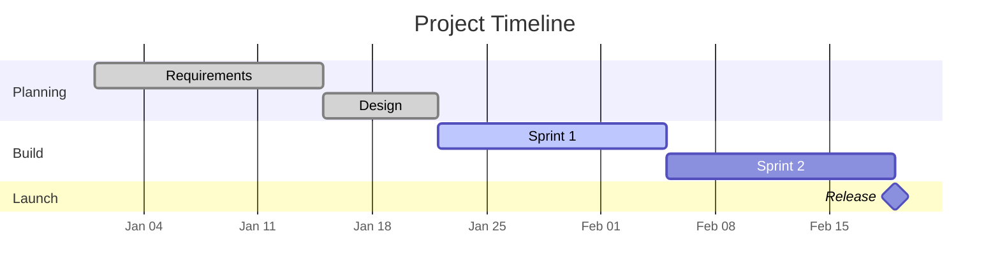
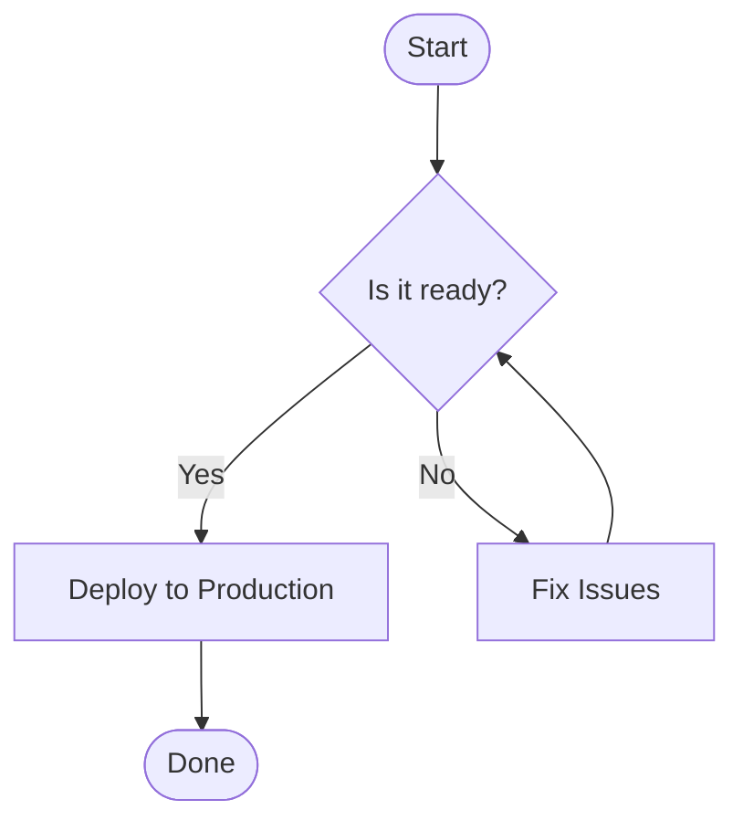
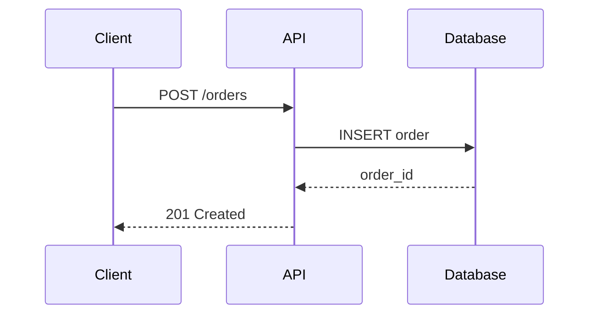
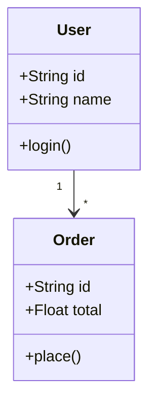
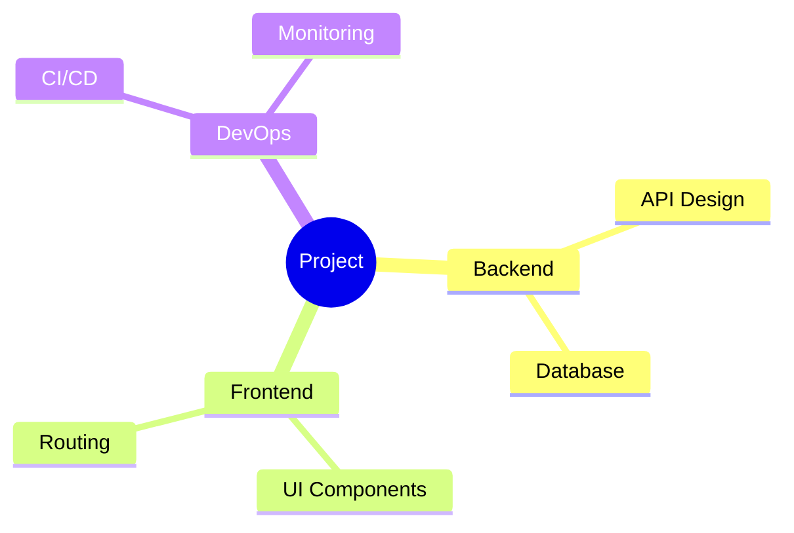
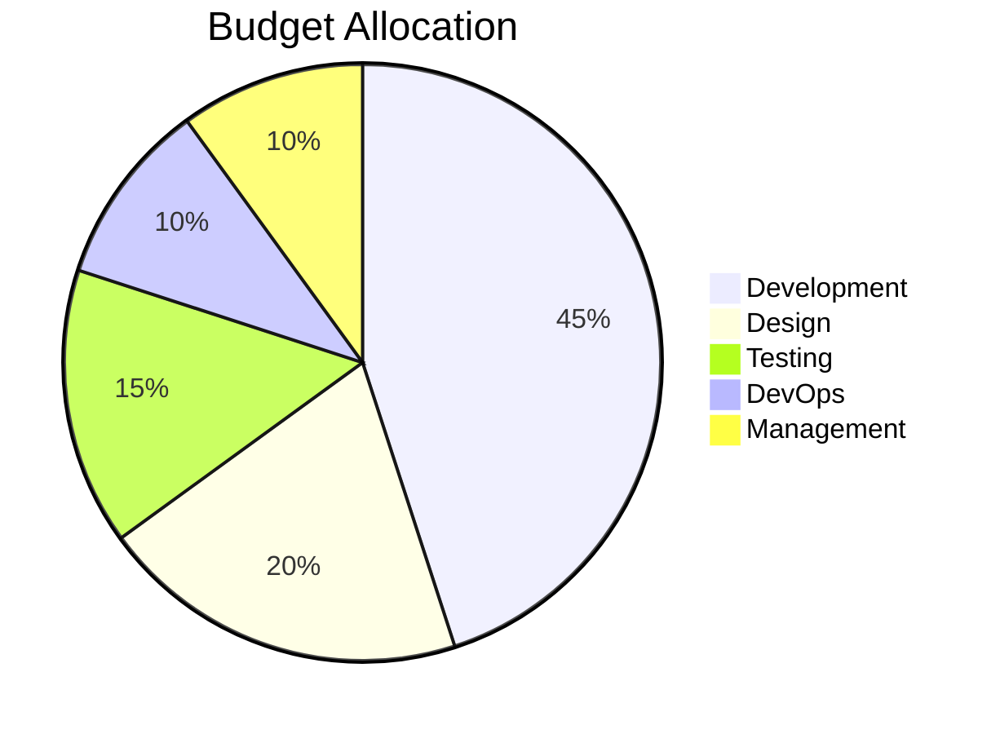
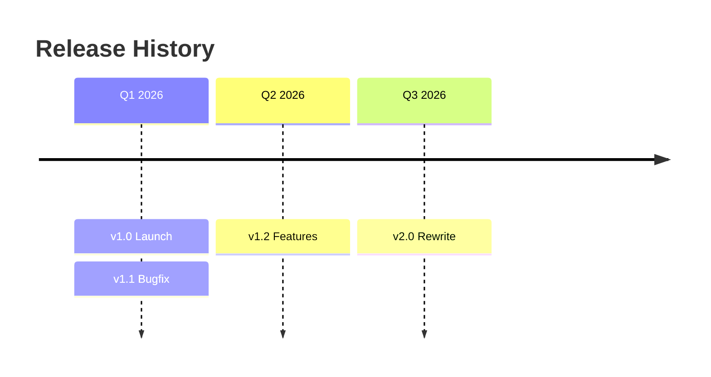

# Obsidian Vault Skill

You have access to tools for reading, writing, searching, visualizing,
and managing projects in Obsidian vaults. Use these tools to help the
user build and maintain their knowledge base.

## Available Tools

### Core
| Tool | Purpose |
|------|---------|
| `obsidian_list_vaults` | List all discovered Obsidian vaults |
| `obsidian_list_notes` | List all .md notes in a vault (tree view by directory) |
| `obsidian_read` | Read a note, optionally parsing YAML frontmatter |
| `obsidian_write` | Create or overwrite a note |
| `obsidian_append` | Append content to an existing note (creates if missing) |
| `obsidian_search` | Search notes by filename and/or content |

### Knowledge Discovery
| Tool | Purpose |
|------|---------|
| `obsidian_list_tags` | List all tags across a vault with usage counts |
| `obsidian_list_backlinks` | Find notes linking to a target note via [[wikilinks]] |

### Visualization
| Tool | Purpose |
|------|---------|
| `obsidian_create_mermaid` | Generate Mermaid diagrams (flowchart, gantt, sequence, class, mindmap, pie, timeline) |
| `obsidian_create_canvas` | Create Obsidian Canvas files (.canvas) with nodes and edges |

### Project Planning
| Tool | Purpose |
|------|---------|
| `obsidian_create_kanban` | Create Kanban board notes with columns and tasks |
| `obsidian_create_project_dashboard` | Create project overview with goals, milestones, Gantt chart, Dataview queries |
| `obsidian_create_daily_note` | Create structured daily notes (default, meeting, planning templates) |

## Vault Resolution

Vaults can be referenced by:

- **Name** — the folder name shown in Obsidian (e.g., `"Personal"`)
- **Absolute path** — direct filesystem path (e.g., `"C:/Users/who/Documents/Vault"`)
- If no vault is specified, `obsidian_list_vaults` returns all discovered vaults

Vaults are auto-discovered from Obsidian's `obsidian.json` config file.

---

## Project Planning in Obsidian

### Vault Structure

Organize your vault for project work using this folder layout:

```
vault/
├── projects/          # One folder per project
│   └── Project Name/
│       ├── Dashboard.md        # Project overview (use obsidian_create_project_dashboard)
│       ├── Kanban.md           # Task board (use obsidian_create_kanban)
│       ├── Notes/              # Meeting notes, decisions, research
│       └── Resources/          # Reference materials
├── daily/              # Daily notes (use obsidian_create_daily_note)
├── templates/          # Reusable note templates
├── resources/          # Shared reference materials
└── archive/            # Completed projects
```

### Project Lifecycle

1. **Kickoff** — Create a project dashboard with `obsidian_create_project_dashboard`
2. **Planning** — Break work into milestones; create a Kanban board
3. **Execution** — Use daily notes for standup/planning, update Kanban tasks
4. **Review** — Use backlinks to find related notes; tags for aggregation

### Integration Pattern

The tools work together:
- Dashboard → shows the big picture (goals, timeline, team)
- Kanban → tracks day-to-day tasks with status
- Daily notes → capture meeting notes with #project/tag for Dataview
- Canvas → visual layout of project architecture or research
- Backlinks → see what connects to what

---

## Mermaid Diagrams

Obsidian natively renders Mermaid code blocks. Use `obsidian_create_mermaid`
to generate the boilerplate, then edit the content with specific details.

### Gantt Chart (project timelines)



### Flowchart (decision trees, processes)



### Sequence Diagram (API flows, interactions)



### Class Diagram (architecture, data models)



### Mindmap (brainstorming)



### Pie Chart (budget, allocation)



### Timeline (historical tracking)



---

## Kanban Board Patterns

### Standard Columns

```
Backlog → Todo → In Progress → Review → Done
```

### Column Customization by Workflow

**Software Development:**
```
Backlog | Ready | In Progress | Code Review | QA | Done
```

**Content Creation:**
```
Ideas | Research | Drafting | Review | Published
```

**Personal Tasks:**
```
Inbox | Today | In Progress | Waiting | Done
```

### Task Formatting

- **Simple tasks**: `- [ ] Fix login bug`
- **Priority markers**: `- [ ] 🔴 Critical: Deploy hotfix`
- **Linked tasks**: `- [ ] Implement [[Feature Spec]]`
- **Dated tasks**: `- [ ] Review Q1 report 📅 2026-03-15`
- **Tagged tasks**: `- [ ] Update docs #documentation #sprint-3`

### Best Practices

- Limit WIP (Work In Progress) — aim for 3-5 tasks per person in "In Progress"
- Move completed tasks to Done; archive periodically
- Link complex tasks to dedicated notes for details
- Use `obsidian_list_backlinks` to find tasks referencing a feature note

---

## Canvas Best Practices

### When to Use Canvas vs Markdown

| Canvas | Markdown Note |
|--------|---------------|
| Visual brainstorming | Linear documentation |
| Architecture diagrams | Meeting notes |
| Research synthesis (multiple sources) | Single-topic deep dives |
| Project overviews with spatial layout | Task lists and logs |
| Mind maps and concept maps | Code snippets and references |

### Node Organization

- **Text nodes** — freeform markdown content, great for ideas and notes
- **File nodes** — link to existing notes; changes sync automatically
- **Group nodes** — visually organize related nodes with a label and background

### Layout Patterns

- **Left-to-right flow**: Process flows, pipelines, timelines
- **Hub and spoke**: Central concept with related topics radiating outward
- **Grid layout**: Comparison tables, feature matrices
- **Freeform**: Brainstorming, mind maps

### Edge Labeling

Always label edges connecting nodes to show the relationship:

```
[User Stories] -- "informs" --> [API Design]
[API Design] -- "implemented by" --> [Backend Sprint]
[Database Schema] -- "supports" --> [API Design]
```

---

## Dataview Queries

These queries work with the Obsidian Dataview plugin and are included in project dashboards.

### Task Aggregation

```dataview
TASK
FROM "projects"
WHERE contains(tags, "#project/my-project")
```

### Note Listing (by project)

```dataview
LIST
FROM "projects/My Project"
SORT file.name ASC
```

### Date-Based Views

**Overdue tasks:**
```dataview
TASK
WHERE !completed AND date(file.name) < date(today)
```

**This week's notes:**
```dataview
LIST
FROM "daily"
WHERE file.day >= date(today) - dur(7 days)
SORT file.day DESC
```

**Upcoming milestones (from frontmatter):**
```dataview
TABLE milestone-date AS "Date", status AS "Status"
FROM "projects"
WHERE milestone-date
SORT milestone-date ASC
```

### Tag-Based Filtering

```dataview
TABLE file.tags AS "Tags"
FROM #meeting OR #decision
SORT file.name DESC
LIMIT 20
```

---

## Templates

### Daily Note (`default` template)

Created by `obsidian_create_daily_note` with `template: "default"`:

```markdown
---
date: 2026-01-15
tags:
  - daily
---

# Wednesday, January 15, 2026

## 📋 Tasks
- [ ] Task one
- [ ] Task two

## 📝 Notes
...

## 🤝 Meetings
- Standup at 9:30am

## 🙏 Gratitude
- ...
```

### Meeting Notes (`meeting` template)

Created by `obsidian_create_daily_note` with `template: "meeting"`:

```markdown
---
date: 2026-01-15
tags:
  - daily
  - meeting
---

# Wednesday, January 15, 2026

## Agenda
- [ ] Item 1
- [ ] Item 2

## Attendees
- Alice, Bob, Carol

## Notes
...

## Action Items
- [ ] Alice: Follow up on Q1 budget
- [ ] Bob: Update project timeline

## Follow-up
- Next meeting: Jan 22
```

### Daily Planning (`planning` template)

Created by `obsidian_create_daily_note` with `template: "planning"`:

```markdown
---
date: 2026-01-15
tags:
  - daily
  - planning
---

# Wednesday, January 15, 2026

## 🎯 Today's Focus
1. Complete API integration
2. Review PR #42
3. Plan sprint demo

## 📋 Tasks
### Must Do
- [ ] Ship the feature

### Should Do
- [ ] Update docs

### Could Do
- [ ] Refactor helper

## 📝 Notes
...

## 🔄 Review
- What went well:
- What to improve:
- Blockers:
```

### Weekly Review Template

```markdown
---
week: 2026-W03
tags:
  - weekly-review
---

# Weekly Review: Week 3, 2026

## 🏆 Wins
- 
- 

## 📊 Metrics
- Tasks completed:
- Hours tracked:
- Milestones hit:

## 🔄 In Progress
- 

## 🚧 Blockers
- 

## 📝 Lessons Learned
- 

## 🎯 Next Week's Focus
1. 
2. 
3. 

## 📅 Upcoming
- [ ] 
```

### Project Kickoff Template

```markdown
---
project: "Project Name"
created: YYYY-MM-DD
status: active
tags:
  - project/project-name
  - kickoff
---

# 🚀 Project Kickoff: Project Name

## Problem Statement
What problem are we solving?

## Success Criteria
- [ ] Criterion 1
- [ ] Criterion 2

## Scope
### In Scope
- 

### Out of Scope
- 

## Stakeholders
| Role | Person | Involvement |
|------|--------|-------------|
| Sponsor | | High-level decisions |
| PM | | Day-to-day |
| Tech Lead | | Architecture |

## Risks
| Risk | Impact | Mitigation |
|------|--------|------------|
| | | |

## Timeline
See [[Project Dashboard]] for detailed Gantt chart.

## Decisions
- 

## Next Steps
- [ ] Create project dashboard
- [ ] Set up Kanban board
- [ ] Schedule kickoff meeting
```

---

## Tag Conventions

### Project Tags

```
#project/name        — all project-related notes
#milestone/name      — milestone-specific tasks
#kanban              — Kanban board notes
#dashboard           — project dashboard notes
```

### Status Tags

```
#todo                — needs attention
#in-progress         — actively working
#done                — completed
#blocked             — waiting on something
#cancelled           — no longer needed
```

### Type Tags

```
#meeting             — meeting notes
#decision            — architectural/product decisions
#research            — investigation and findings
#idea                — brainstorming, possibilities
#documentation       — docs and reference
#bug                 — bug reports
#feature             — feature requests
```

### Priority Tags

```
#p0                  — critical / drop everything
#p1                  — high priority / this sprint
#p2                  — medium / next sprint
#p3                  — low / backlog
```

### Tag Best Practices

1. **Be consistent** — pick a convention and stick to it across the vault
2. **Use `obsidian_list_tags`** periodically to audit and clean up tag sprawl
3. **Nest tags** — `#project/api`, `#project/frontend` for sub-categories
4. **Don't over-tag** — 3-5 tags per note is usually enough
5. **Frontmatter tags** for structured metadata; inline `#tags` for quick categorization

---

## Obsidian Markdown Conventions

### YAML Frontmatter

```yaml
---
title: "My Note"
tags:
  - tag1
  - tag2
created: 2026-01-15
aliases:
  - Alternate Name
---
```

### Wikilinks

```markdown
[[Note Name]]
[[Note Name|Display Text]]
[[Note Name#heading]]
[[Note Name#heading|Custom Text]]
```

### Embeds

```markdown
![[Note Name]]
![[image.png|300]]
```

### Callouts

```markdown
> [!note] Title
> Content here.

> [!warning] Warning
> Pay attention.

> [!tip] Pro Tip
> Helpful advice.

> [!danger] Critical
> Must be addressed.

> [!example] Example
> Demonstrative content.

> [!quote] Quote
> Someone said this.
```

---

## Best Practices

1. **Discover vaults first** — before any operation, use `obsidian_list_vaults` to find available vaults.

2. **Search before reading** — `obsidian_search` is faster than reading individual notes.

3. **Preserve frontmatter** — when modifying notes, read first with `parse_frontmatter: true`.

4. **Use append for journals** — daily notes, logs, and meetings should use `obsidian_append` or `obsidian_create_daily_note`.

5. **Check before overwriting** — use `obsidian_read` to confirm before calling `obsidian_write`.

6. **Tag consistently** — use the tag conventions above. Run `obsidian_list_tags` periodically.

7. **Dashboard + Kanban + Daily notes** — this trio is the foundation of project management in Obsidian.

8. **Canvas for spatial thinking** — use Canvas when relationships are non-linear.

9. **Backlinks for navigation** — use `obsidian_list_backlinks` to understand how notes interconnect.

10. **Dataview for aggregation** — design your tags and frontmatter so Dataview queries can surface the right information.
